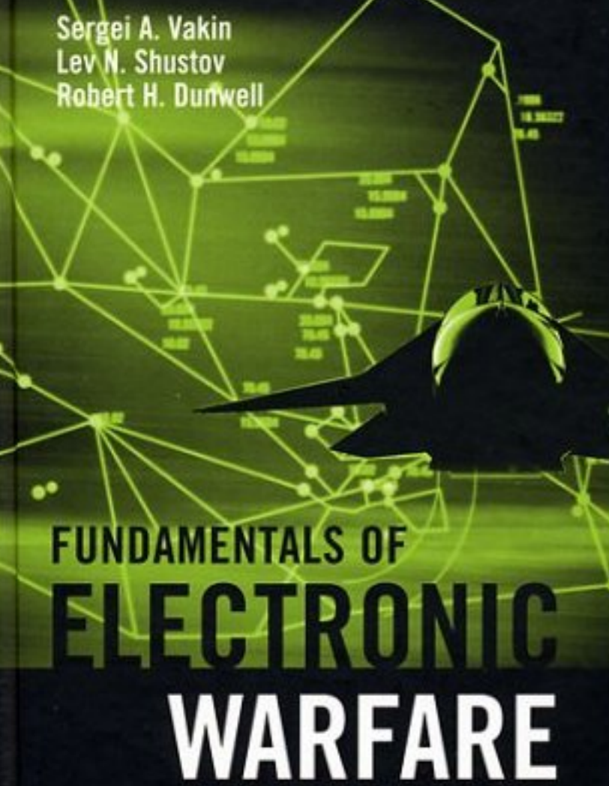

# Book Recommendation | "Electronic Warfare Fundamentals": A Classic Work Deeply Rooted in Theory and Practice of Electronic Warfare

1.1 Electronic Warfare Target Core Types
The book "Electronic Warfare Fundamentals" was published in 2001, focusing on the core role of electronic warfare in military contexts - disrupting and destroying enemy electronic systems (such as radar, communication, navigation systems) through electronic means while protecting one's own electronic equipment from interference by the enemy. The book adopts a "systems methodology" as its core framework, covering both the basic theory of electronic warfare and in-depth mathematical modeling and practical effectiveness assessment, bridging the gap between theory, modeling, and application in the field of electronic warfare.
Historically, the book traces the developmental trajectory of electronic warfare: from passive jamming by British forces during World War II using silver foil to post-war "competition - upgrade" iterations of radar and electronic warfare systems (such as non-coherent radar, pulse coherent radar, phased array radar, and corresponding developments in jamming technology), clearly presenting the logic of how electronic warfare technology evolves with military needs.
II. Core Content Framework: From Target Modeling to Practical Applications
The structure of this book is rigorous, consisting of 7 chapters divided into four major modules: "Electronic Warfare Target Analysis," "Interference Signal and System Modeling," "Effectiveness Assessment Standards," and "Specific Interference Techniques." These modules progressively analyze the complete system of electronic warfare.
Module 1: Mathematical Modeling of Electronic Warfare Targets (Chapter 1)
The core of electronic warfare lies in "targeted interference against enemy electronic systems," so this book first focuses on precise modeling of "electronic warfare targets" - clarifying which systems are the main targets of interference and how to describe their working principles in mathematical language, providing a basis for subsequent interference scheme design.
1.1 Electronic Warfare Core Target Types
The book defines the core types of electronic warfare targets as follows:
• Radar systems: air defense radar (detection, guidance, target indication radar), airborne radar, synthetic aperture radar (SAR), etc., are the "eyes" of modern air defense systems and are also the most vulnerable links to be interfered with.
• Communication and navigation systems: command communication lines for air defense forces, high-precision satellite navigation systems (such as early American high-precision navigation systems), interfering with these systems can paralyze the enemy's command chain and weapon positioning capabilities.
Automated Control Systems: Autonomous Air Defense Forces Control System (AAD Forces Control), Autonomous Air Defense Weapons Control System (AAD Weapons Control), such as missile guidance loops, fighter interception command systems.
1.2 Mathematical Model of the Objective (Key Point) The book extensively constructs a mathematical model for the objective, laying the foundation for "quantifying the effect of disturbances," with the core model including:
•  
Optimal Radar Receiver Model:
•  
Optimal Detector in Search Mode: Based on the Naive-Pearson criterion (maximizing detection probability under a fixed false alarm probability), derive the likelihood ratio formula for signal detection, and clarify the impact of "signal energy / noise spectral density" (E/N₀) on detection effectiveness.
•  
Optimal Receiver in Tracking Mode: Estimation of parameters for radar tracking targets (angle, distance, velocity) - Establish a Kalman filter model. Analyze the impact of noise on tracking accuracy, such as dynamic and random error models of angle measurement devices.
•  
Optimal Receive Model for Communication and Navigation Systems:
•  
Taking binary communication system as an example, based on the "ideal observer criterion", derive the formulas of bit error rate for different modulation methods (AM, FM, PM) and clarify that the frequency modulation system has the best anti-interference capability (the lowest bit error rate), followed by AM system.
•  
Automation control system model:
•  
Air Defense Force Command System: The target allocation process is described using the "Multi-Channel Service System" model (with rejection mechanism), comparing the service probability differences between "centralized control" and "decentralized control" (for example, the service probability is higher under centralized control but has weaker anti-interference capability).
•  
Air Defense Weapon Control System: Taking missile guidance as an example, establish a proportional navigation (PN) guidance law model, derive the missile miss distance formula, and clarify the impact of "line-of-sight angular velocity" and "missile acceleration" on the miss distance - this is the core theoretical basis for subsequent "interfering with the angle measurement channel to increase the miss distance."
Module 2: Mathematical Modeling of Interference Signals and Systems (Chapter 2) After defining the objectives, this book further addresses "How to Design Interference Signals and Systems," providing a comprehensive design framework from interference signal classification, mathematical models, to the structure of interference systems.
2.1 Core classification of interference signals and model book: The interference signals are divided into three categories, each with clear mathematical expressions and application scenarios.
•  
Destructive interference signal:
•  
Principle: By emitting high-energy electromagnetic radiation, the enemy's receiver components (such as semiconductor devices) are destroyed, causing irreversible damage.
•  
Quantitative Metrics: Derive the formula for the minimum radiation power required for destruction, such as for a radar receiver. Consider factors like the distance between the interference source and the target, the effective area of the receiving antenna, and the polarization coefficient, to conclude that "pulse power above 0.5W is necessary within the radius of destruction" (for frequencies above 10GHz).
•  
Masking interference signal:
•  
Function: By masking useful signals with noise-like signals, the enemy cannot detect the target. The core is "randomness" (to avoid being suppressed by the enemy using simple algorithms).
•  
Model:
•  
White Noise Model: Assuming the noise spectral density is uniform, derive its correlation function and power spectral density (based on Wiener-Khinchin theorem), clarify the principle that "the noise bandwidth needs to cover the target signal bandwidth".
•  
Angle Noise Model: For radar angle tracking channels, a "dual-source switching" angle noise model (similar to telegraph signal switching) is established. The spectral density formula is derived, providing a basis for "using angle noise to disrupt radar tracking."
•  
Deceptive interference signal:
•  
Function: Simulate real target signals (such as radar reflection signals), mislead the enemy to treat a false target as a real one, with the core being "signal parameters are consistent with the real target."
•  
Model: Taking radar decoy targets as an example, the paper derives the formula of "decoy target recognition probability" when the entropy difference between the decoy signal and the true signal is minimal.
2.2 Structure and Model of Interference System The typical block diagram of the automation interference system is given in the book, including:
•  
Information Support System: Electronic Intelligence (ELINT) receiver, knowledge base and database (to store enemy radar parameters), for "identifying target types - selecting jamming strategies".
•  
Interference Signal Generation System: modulator, high-frequency amplifier, antenna, capable of generating covert and deceptive signals.
•  
Control logic: Based on "game theory", the interference strategy selection is made, such as automatically switching the parameters of the jamming signal according to the enemy's different radar types (non-coherent, coherent).
Module 3: Evaluation Criteria for Electronic Warfare Effects (Chapter 3) Interference effects cannot be judged by "subjective feelings." This book proposes four categories of quantitative indicators, providing a unified standard for assessing whether an interference is effective.
3.1 Information Indicators: Evaluate the degree of "information damage".
Core logic: The essence of jamming is "denying the enemy's ability to obtain information," quantifying information uncertainty with "entropy" - the greater the entropy of the jamming signal, the less effective information the enemy can obtain.
•  
Key indicators:
•  
Entropy power: Comparing the entropy power of the interfering signal with that of Gaussian noise, if the entropy power of the interfering signal is close to that of Gaussian noise (maximum entropy), then the masking effect is optimal.
•  
Information Loss Quantity: Taking radar as an example, the "uncovered volume" (interference corridor) caused by interference divided by the radar pulse volume is the number of information bits lost per pulse volume (each pulse volume contains 1 bit of information, due to detection / non-detection probabilities being 0.5 each).
3.2 Energy Metrics: Quantify the "Interference-Signal Power Ratio" (J/S)
Core logic: Whether the interference is effective depends on whether the "interference power to useful signal power ratio" reaches the "interference coefficient" (Kj) — that is, the "minimum J/S ratio."
•
Key derivation:
•
Radar interference coefficient: For search radars, derive the Kj formula based on false alarm probability (Pfa) and detection probability (Pdet), for example, when Pfa=0.001 and Pdet=0.1, Kj=0.62 (meaning the interference power needs to be more than 0.62 times the signal power).
•
Tracking radar interference coefficient: For angle tracking channels, derive the relationship between "angle noise spectral density" and J/S, clarifying that "to cause missile misses beyond kill range, angle interference must make J/S≥10-12dB."
3.3 Tactical operational indicators: Linking interference effects with battlefield outcomes
•
Core logic: The ultimate goal of interference is "to reduce own losses and enhance combat success rate," which is quantified in the book by "penetration air defense system probability" and "average loss rate."
•
Key models:
•
Air defense system penetration probability: Based on a "Poisson flow" to describe enemy fire channel, derive the "interference after penetration probability" formula — for example, if the enemy's missile hit rate drops from 0.2 to 0.1 after interference, the penetration probability increases from 37% to 67%.
•
Fighter formation loss model: Comparing the loss rates with and without interference, for example, during World War II, British forces using smoke screens reduced bomber losses from 10% to 5% after interference.
3.4 Military economic indicators: Balancing "interference cost vs. benefits"
•
Core logic: The cost-effectiveness of an interference system is key, with the "efficiency-cost ratio" being proposed as an indicator — for example, "how much less a fighter aircraft loses per unit of interference system cost" or "the total benefit (avoided losses) over the lifespan of the interference system compared to its cost."
Module 4: Specific Interference Techniques and Applications (Chapters 4-7) Based on the theories and models presented in Chapters 2, this book offers specific interference schemes and formulas tailored to different objectives, directly guiding engineering practice.
4.1 Radar Active Interference: Derivation and Application of the Interference Equation
Core: Derive the formula for "Interference Power / Signal Power Ratio" (K), clarifying the relationship between K and "Interference Source Power, Distance, Target RCS, Antenna Gain".
(where P_j is the interference power, G_j is the interference antenna gain, σBF is the target formation RCS, Ds is the distance between the target and the radar, Dj is the distance between the interference source and the radar)
•  
Application: Adjust formula parameters for different radar types (single, dual, and Synthetic Aperture Radar), such as the interference area for a dual-baseline radar is "Cassini Egg Line" instead of a circular area for a single-baseline radar.
4.2 Radar Passive Interference: Application of Sheet Metal (Chaff)
Core: Form a "flare cloud" by releasing foils to simulate the target's radar cross section (RCS) for camouflaging real targets, as deduced in the book.
•  
Fishing Debris Cloud (RCS): The RCS formula for a single half-wave dipole fishing debris cloud, as well as the RCS density of a fishing debris cloud (proportional to the number of fishing debris and their distribution density).
•  
Interference Effect: Derive the "Ratio of Radar detection distance reduction by strips". For example, if 1000 strips are deployed, the radar's detection distance for fighter aircraft can be reduced from 100km to 50km.
4.3 False Targets and Decoy Technology•
Core: Designing fake targets (such as drag baits, one-time baits) to simulate real target parameters. The book explicitly states:
•  
False target RCS enhancement method: amplify radar signals with "transmitters" or enhance RCS with "passive reflectors" (such as corner reflectors) to make the false target RCS comparable to that of the true target.
•  
Prey deployment timing: Based on the missile guidance time model, it is deduced that "the prey must be deployed 5-10 seconds before the missile enters its final guidance phase to effectively mislead the missile's tracking of a decoy target."
4.4 Reduce the radar detectability of aircraft
Core: Reduce the probability of being detected from "the target itself", the book introduces two types of technologies:
•  
Absorptive coating: Derive the "reflection coefficient" formula for an absorptive coating, and clarify that "the best absorption effect occurs when the coating thickness is λ/4" (where λ is the radar wavelength).
•  
Aerodynamic Design: By employing "inclined body" and "concealed engine intake", the radar wave reflection is reduced, such as the early F-117 prototype's aerodynamic design, which reduces RCS from 10 square meters to 0.01 square meters.
III. The Value and Appropriate Audience of This Book 1. Core Value •
Theoretical depth: The "target-interference-effect" link of electronic warfare is quantified by mathematical models, avoiding the vagueness of "qualitative descriptions", which is a "founding work" in electronic warfare theory.
•  
Practical Guidance: All models and formulas are based on real military scenarios (such as WWII jamming cases, missile guidance loops), which can be directly applied to engineering design (such as jamming power calculation, decoy parameter design).
•  
Historical Perspective: Organizing the developmental trajectory of electronic warfare from World War II to the year 2000, this aids readers in comprehending the "iterative logic of technological confrontation"—the evolution of radar and jamming always follows a dialectical relationship of "identifying vulnerabilities - devising countermeasures - new vulnerabilities emerge."
2. Applicable Populations
Military enthusiasts: delve into the technical principles behind electronic warfare, rather than merely remaining at the surface understanding of "interference = shielding signals."
•  
Electronic Engineering / Military Engineering practitioners: Provide theoretical basis for the design of radar jamming systems and missile anti-jamming designs.
•  
College students in relevant fields: As a supplementary textbook to the "Electronic Warfare" and "Radar Systems" courses, this material aims to facilitate an understanding of the integration of theory with practice.
IV. Summary
"Electronic Warfare Fundamentals" is not merely a "general military science popularization," but rather a classic that combines theoretical rigor with practical guidance. It dissects the core logic of electronic warfare using mathematical language, from "target modeling" to "interference design" to "effect evaluation," forming a complete knowledge loop. Whether you are interested in delving deeper into electronic warfare technology or seeking references for related engineering practices, this book is worth revisiting—it not only answers "how to interfere," but also teaches the underlying logic behind "why to interfere in this way."
If you are interested in modern military technology, electronic countermeasures, or work in related fields, this book is an indispensable "authoritative reference" on your bookshelf.
End

## Images

<!-- PAYMENT_BLOCK -->

## Get this dataset

- Payment link (Stripe): [Buy now](https://buy.stripe.com/3cs8yP7sY87d0vu9AB)
- Payment QR code: 

<!-- /PAYMENT_BLOCK -->
